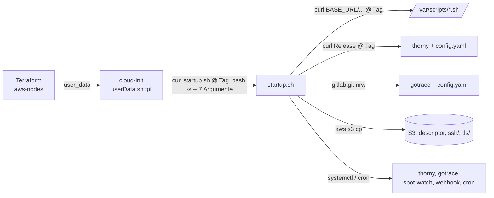
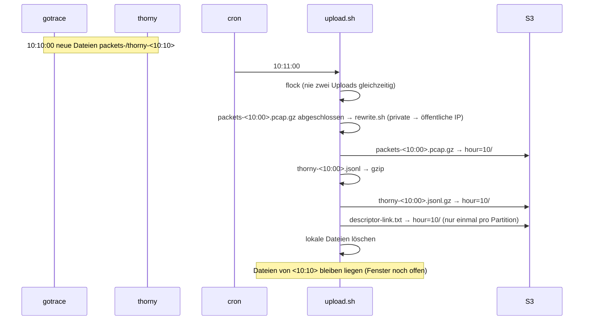
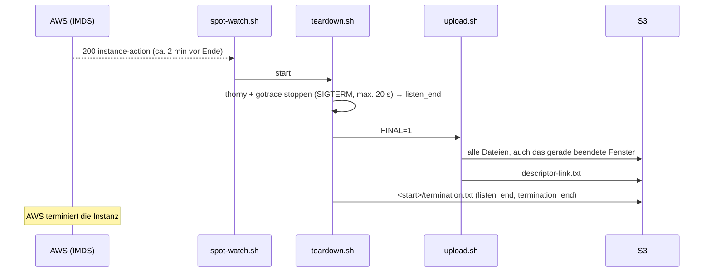

# cthorny Deployment (Cloud-Sensoren)

Dieses Verzeichnis enthält alles, was eine Cloud-VM zu einem cthorny-Sensor macht: Bootstrap, Upload nach S3, sauberes Beenden bei einer Spot-Unterbrechung und einen lokalen Test mit Docker.
Die Skripte basieren auf [CAIDA cloudtelescope-public](https://github.com/CAIDA/cloudtelescope-public) (`scripts/`). Die Abweichungen stehen [am Ende](#abweichungen-vom-caida-original).

## 1. Überblick: Was läuft auf einem Sensor?

| Komponente | Aufgabe | Start |
|---|---|---|
| **thorny** | Honeypot, antwortet auf SSH (22), Telnet (23), SMTP (25) und LDAP (389), schreibt JSONL-Logs | `thorny.service` |
| **gotrace** | zeichnet alle IP-Pakete am Interface als pcap auf | `gotrace.service` (aus dem gotrace-Repo) |
| **upload.sh** | lädt abgeschlossene Datenfenster nach S3 hoch und löscht sie lokal | cron, alle 10 Minuten |
| **spot-watch.sh** | wartet auf die Spot-Unterbrechungswarnung und startet dann `teardown.sh` | `spot-watch.service` |
| **webhook** | HTTPS-Steuerung von außen: `ping`, `status`, `teardown`, `restart`, `redeploy` | `webhook.socket` (Port 51337, nur IPv6) |
| **sshd** | echter SSH-Zugang, verschoben auf Port **28763** | Ubuntu |

Eine **Spot-Instanz** ist eine normale EC2-VM, nur günstiger. AWS kann sie aber jederzeit zurückholen und kündigt das etwa **2 Minuten vorher** über den Metadaten-Dienst (IMDS) an. In diesen 2 Minuten lädt der Sensor alles hoch und schreibt `termination.txt`.

## 2. Bootstrap-Kette



`userData.sh.tpl` lädt `startup.sh` aus dem Git-Tag `THORNY_VERSION` und ruft es bei **jedem Boot** auf (`cloud_final_modules: scripts-user, always`):

```
THORNY_VERSION=<tag> startup.sh <bucket> <s3-endpoint> <s3-access-key> <s3-secret-key> <webhook-pw> <provider> <region>
```

Skripte, thorny-Binary und thorny-Config kommen alle aus demselben Tag (siehe [Versionierung](#versionierung)).

| # | Argument | Beispiel | Wird zu |
|---|---|---|---|
| 1 | Bucket | `cthorny-data` | `bucket.txt` |
| 2 | S3-Endpoint | `https://s3.amazonaws.com` | `storageLoc.txt` |
| 3/4 | Access/Secret Key | | `storageAccKey.txt` / `storageSecKey.txt` |
| 5 | Webhook-Passwort | | `webhookPw.txt`, `/etc/webhook.json` |
| 6 | Provider | `aws` | `provider.txt`, Pfad `provider=` |
| 7 | Region (bei AWS die AZ) | `eu-central-1a` | `region.txt`, Pfad `region=` |

Ablauf von `startup.sh`:
1. apt-Pakete installieren, Skripte nach `/var/scripts` laden.
2. Lifecycle anlegen: `start=$(date +%s)` in `start.txt` schreiben, alte `linked/`-Marker löschen.
3. Binaries laden: AWS CLI v2, webhook und thorny passend zur Architektur (amd64/arm64), gotrace nur für amd64.
4. gotrace konfigurieren: `##IFACE##` ersetzen, `split_time` auf `ROTATE_MINUTES` setzen.
5. Öffentliche IPv4 ermitteln: `PUBLIC_IP`, sonst IMDS (`meta-data/public-ipv4`, nur bei AWS), sonst `dig`.
6. thorny-Config: `##PUBLICIP##` und `rotateMinutes` setzen.
7. AWS-CLI-Config schreiben (siehe [S3-Zugang](#s3-zugang)), `descriptor.txt` erzeugen und nach `<lifecycle>/descriptor.txt` hochladen.
8. cron einrichten, SSH auf 28763 verschieben, resolv.conf setzen, webhook starten.
9. gotrace, thorny und spot-watch starten.
10. Warten, bis thorny seine SSH-Host-Keys und das TLS-Zertifikat erzeugt hat (höchstens 60 s), dann `ssh/` und `tls/` hochladen.

> Ein Reboot (z. B. über den Webhook `restart`) startet `startup.sh` neu und damit einen **neuen Lifecycle**. Der alte bekommt dann keine `termination.txt`.

## 3. Dateien auf der Instanz

| Pfad | Inhalt |
|---|---|
| `/root/config/*.txt` | Argumente (siehe oben), `version`, `ip4`, `ip6`, `start` (Lifecycle-Start), `window_minutes`, `teardownState` (`available` → `started` → `finished`) |
| `/root/config/descriptor.txt` | lokale Kopie des Deskriptors |
| `/root/config/termination.txt` | lokale Kopie, nach dem teardown |
| `/root/config/linked/` | Marker: Für diese Partition wurde `descriptor-link.txt` schon geschrieben |
| `/root/config/thorny/ssh/`, `/root/config/thorny/tls/` | von thorny erzeugte Host-Keys und Zertifikat (Pfade aus `/etc/thorny/config.yaml`) |
| `/root/config/aws/config`, `credentials` | Region, Endpoint und Keys für die AWS CLI (`credentials` nur, wenn Keys übergeben wurden) |
| `/root/config/cert.pem`, `key.key` | Zertifikat des Webhook-Servers |
| `/var/spool/gotrace/packets-<unix>.pcap.gz` | pcaps, noch nicht hochgeladen |
| `/var/spool/thorny/thorny-<unix>.jsonl` | thorny-Logs, noch nicht hochgeladen |
| `/etc/thorny/config.yaml` | aus [`thorny/cmd/aws-config.yaml`](../cmd/aws-config.yaml) |
| `/etc/gotrace/config.yaml` | aus dem gotrace-Repo, angepasst |
| `/var/scripts/` | `lib.sh`, `upload.sh`, `rewrite.sh`, `teardown.sh`, `spot-watch.sh`, Webhook-Skripte |
| `/usr/lib/systemd/system/` | `thorny.service`, `gotrace.service`, `spot-watch.service`, `webhook.{service,socket}` |
| `/var/log/cthorny-upload.log` | Ausgabe der cron-Uploads |

## 4. Layout im S3-Bucket

```
<bucket>/provider=<p>/region=<r>/ip=<a-b-c-d>/
├── <unix-Start>/                       ← ein Ordner pro Lifecycle (IPs werden wiederverwendet)
│   ├── descriptor.txt                  ← beim Boot
│   ├── ssh/id_ed25519, id_rsa, id_ecdsa  ← thorny-Host-Keys, direkt nach dem Start
│   ├── tls/cert.pem, key.pem           ← thorny-Zertifikat, direkt nach dem Start
│   └── termination.txt                 ← als letzte Datei beim teardown
└── year=YYYY/month=MM/day=DD/hour=HH/  ← UTC
    ├── packets-<unix>.pcap.gz          ← gotrace, ein Datenfenster
    ├── thorny-<unix>.jsonl.gz          ← thorny, dasselbe Fenster
    └── descriptor-link.txt             ← <unix-Start> des Lifecycles, zu dem die Daten gehören
```

- **`descriptor.txt`** ist JSON ohne Zeitstempel. Der Start steckt im Ordnernamen.
  ```json
  {"hostname":"ip-172-31-0-12","provider":"aws","ipv4":"3.120.10.5","ipv6":"2a05:d014::1","os":"Ubuntu22.04.5LTS","region":"eu-central-1a","version":"thorny-v0.1.0"}
  ```
  `version` ist der Git-Tag, mit dem der Sensor gestartet wurde (`dev` im lokalen Test).
- **`termination.txt`**
  ```
  listen_end=1795003320        # thorny + gotrace gestoppt
  termination_end=1795003341   # finaler Upload fertig
  ```
  Fehlt die Datei, endete der Lifecycle ohne sauberen teardown, etwa durch einen Absturz, einen harten Stopp oder einen Reboot.
- **`descriptor-link.txt`** enthält normalerweise genau eine Zeile `<unix-Start>`. Teilen sich zwei Lifecycles derselben IP eine Stunde (z. B. nach einem Reboot), stehen beide Startzeiten darin, eine pro Zeile.
- **`<unix>` der Datendateien** ist der Beginn des Datenfensters. Er ist durch die Fensterlänge teilbar (600 s), und die `hour=`-Partition wird daraus berechnet.

Beispiel für einen Lifecycle, der am 18.11.2026 um 10:13:20 UTC startet:
```
provider=aws/region=eu-central-1a/ip=3-120-10-5/1794996800/descriptor.txt
provider=aws/region=eu-central-1a/ip=3-120-10-5/1794996800/ssh/id_ed25519
provider=aws/region=eu-central-1a/ip=3-120-10-5/1794996800/tls/cert.pem
provider=aws/region=eu-central-1a/ip=3-120-10-5/year=2026/month=11/day=18/hour=10/packets-1794996600.pcap.gz
provider=aws/region=eu-central-1a/ip=3-120-10-5/year=2026/month=11/day=18/hour=10/thorny-1794996600.jsonl.gz
provider=aws/region=eu-central-1a/ip=3-120-10-5/year=2026/month=11/day=18/hour=10/descriptor-link.txt   → 1794996800
```

Daten und Deskriptor zusammenführen: `provider/region/ip` aus dem Pfad der Datendatei plus den Inhalt von `descriptor-link.txt` ergibt `provider=…/region=…/ip=…/<start>/descriptor.txt`.

## 5. Zeitintervalle und Upload-Ablauf

**Schnitt:** gotrace (`split_time: "10m"`) und thorny (`rotateMinutes: 10`) beginnen an denselben vollen 10-Minuten-Grenzen (UTC) eine neue Datei: :00, :10, :20, :30, :40, :50. Beide Werte setzt `startup.sh` aus `ROTATE_MINUTES`.

**Upload:** cron `1-59/10` startet `upload.sh` um :01, :11, :21 usw. Hochgeladen werden alle Dateien, deren Fenster **abgeschlossen** ist: `<unix> + Fensterlänge <= jetzt`. In eine solche Datei schreibt niemand mehr. Die Minute Abstand zum Schnitt gibt gotrace Zeit, die Datei fertig zu schreiben. Eine Datei, die noch nicht fertig war, wird beim nächsten Lauf hochgeladen.



**Spot-Unterbrechung:** `spot-watch.sh` fragt alle 5 s `meta-data/spot/instance-action` ab. Normal ist die Antwort 404, sobald die Unterbrechung geplant ist 200. Ab dann bleiben etwa 2 Minuten:



Gemessen im lokalen Test: etwa 30 s von der Warnung bis `termination.txt`. Bis zu 5 s dauert das Polling, und 20 s gehen auf gotrace. gotrace puffert jedes Fenster im Speicher und schreibt es erst am Fensterende als `.pcap.gz`. Auf SIGTERM schreibt es das laufende Fenster sofort, beendet sich danach aber nicht selbst und wird nach 20 s per SIGKILL beendet. Die Daten sind dann bereits geschrieben.

`teardown.sh` läuft pro Lifecycle nur einmal, auch wenn Webhook und spot-watch gleichzeitig auslösen. Daten gehen nur verloren, wenn die Instanz *ohne* Warnung stirbt, und dann höchstens die letzten ~11 Minuten.

**Warum rotieren und nicht synchronisieren?** Jede Datei wird genau einmal übertragen und ändert sich danach nicht mehr. Ein Sync würde wachsende Dateien immer wieder komplett hochladen. Zwischen Regionen kostet der Traffic pro GB, und offene pcaps sind noch nicht komprimiert. Außerdem könnte der Analyser halb geschriebene Dateien lesen.

## 6. Zusammenspiel der Skripte

| Skript | aufgerufen von | ruft auf | liest | schreibt |
|---|---|---|---|---|
| `userData.sh.tpl` | cloud-init, jeder Boot | `startup.sh` (curl) | Terraform-Variablen | – |
| `startup.sh` | userData | lädt alle anderen Skripte, `systemctl`, `aws s3` | Argumente, IMDS | `/root/config/*`, `/etc/thorny`, `/etc/gotrace`, S3: `descriptor.txt`, `ssh/`, `tls/` |
| `lib.sh` | wird von allen gesourct | – | `/root/config/*.txt` | – |
| `upload.sh` | cron, `teardown.sh` (`FINAL=1`) | `rewrite.sh`, `aws s3` | Spool-Verzeichnisse | S3: Daten + `descriptor-link.txt`, `linked/`-Marker |
| `rewrite.sh` | `upload.sh` (aws/gcp/azure/…) | `tcprewrite` | `ip4.txt`, Interface-IP | pcap in place |
| `spot-watch.sh` | `spot-watch.service` | `teardown.sh` | IMDS | – |
| `teardown.sh` | spot-watch, Webhook `teardown` | `stop_service`, `upload.sh` | – | `teardownState.txt`, S3: `termination.txt` |
| `status.sh` / `ping.sh` | Webhook | `systemctl is-active` | `/root/config/*` | – |
| `restart.sh` / `redeploy.sh` | Webhook | `reboot` / `cloud-init clean --reboot` | – | – |

Webhook-Aufruf: `curl -k "https://[<ipv6>]:51337/hooks/teardown?token=<webhook-pw>"`. `ping` und `status` brauchen kein Token.

## 7. Konfiguration

| Einstellung | Wo | Standard | Bedeutung |
|---|---|---|---|
| `THORNY_VERSION` | Env von startup.sh, in userData `thorny_version` | – (Pflicht) | Git-Tag, aus dem Skripte und Binaries geladen werden |
| `BASE_URL` | Env von startup.sh | `https://raw.githubusercontent.com/eliasheithecker/cthorny/<THORNY_VERSION>/thorny/deploy` | Quelle der Skripte (`file://` geht auch) |
| `THORNY_RELEASE_URL` | Env von startup.sh | `https://github.com/eliasheithecker/cthorny/releases/download/<THORNY_VERSION>` | Quelle von `thorny-linux-<arch>` und `aws-config.yaml` |
| `ROTATE_MINUTES` | Env von startup.sh | `10` | Fensterlänge für gotrace und thorny, cron-Intervall |
| `PUBLIC_IP` | Env von startup.sh | – | IP-Ermittlung überspringen |
| `S3_REGION` | Env von startup.sh | `us-east-1` | Region des Buckets (für AWS S3) |
| `FINAL` | Env von upload.sh | `0` | `1`: auch offene Fenster hochladen (nur nach dem Stoppen der Dienste) |
| `IMDS_URL` | Env | `http://169.254.169.254` | Metadaten-Dienst (lokal läuft der Mock unter derselben Adresse) |
| `CONFIG_DIR`, `SPOOL_GOTRACE`, `SPOOL_THORNY` | Env, `lib.sh` | `/root/config`, `/var/spool/gotrace`, `/var/spool/thorny` | Pfade |
| `network.primaryIp` | thorny-Config | vom Interface | IP für `sensor_ip`, Dateinamen und TLS-Zertifikat. Auf AWS die öffentliche IP, weil das Interface nur die private kennt |
| `logging.rotateMinutes` | thorny-Config | `10` | Fensterlänge der thorny-Logs |
| `split_time` | gotrace-Config | `1h` → von startup.sh auf `10m` gesetzt | Fensterlänge der pcaps |

### S3-Zugang

Alle Transfers laufen über die **AWS CLI v2** (`aws s3 cp`). Der MinIO-Client `mc` aus dem CAIDA-Original wird nicht mehr verteilt (`dl.min.io/client/mc` antwortet mit HTTP 410). `startup.sh` schreibt `/root/config/aws/config` (Region, bei Nicht-AWS-Endpoints zusätzlich `endpoint_url` und Path-Style) und, falls Keys übergeben wurden, `/root/config/aws/credentials`. `lib.sh` exportiert beide Pfade, sodass jedes Skript einfach `aws s3 …` aufrufen kann.

- **AWS S3:** Endpoint `https://s3.amazonaws.com` (oder leer) und `S3_REGION` auf die Region des Buckets setzen.
- **IAM-Rolle statt Keys:** Access und Secret Key leer lassen. Dann gibt es keine `credentials`-Datei, und die CLI nutzt das Instance Profile.
- **S3-kompatibel (Uni-S3, s3mock …):** Endpoint-URL angeben, Path-Style wird automatisch gesetzt.

### Versionierung

Ein Sensor läuft immer mit genau einem Git-Tag (`THORNY_VERSION`). Daraus ergeben sich:

- Skripte: `raw.githubusercontent.com/eliasheithecker/cthorny/<tag>/thorny/deploy/…`
- Binaries und Config: `github.com/eliasheithecker/cthorny/releases/download/<tag>/…`

Ein Reboot oder `redeploy` lädt also wieder denselben Stand, auch wenn `main` sich inzwischen geändert hat. Eine neue Version wird erst aktiv, wenn `thorny_version` geändert und die Instanz neu gestartet wird.

Tags für thorny heißen `thorny-vX.Y.Z` (das Präfix trennt sie von späteren Releases anderer Komponenten im Repo). Neue Version veröffentlichen:

```bash
git tag thorny-v0.1.0            # auf dem Commit, der deployt werden soll
git push origin thorny-v0.1.0
```

Der Push startet [`.github/workflows/thorny-release.yml`](../../.github/workflows/thorny-release.yml): Tests, `make release`, Syntax-Check der Skripte, dann ein GitHub-Release mit `thorny-linux-amd64`, `thorny-linux-arm64` und `aws-config.yaml`. Tags mit Suffix (z. B. `thorny-v0.1.0-rc.1`) werden als Pre-Release markiert und funktionieren genauso, weil der Tag explizit angegeben wird.

Ein Tag nicht verschieben, wenn schon Sensoren damit laufen. Für Korrekturen einen neuen Tag anlegen.

gotrace wird weiterhin vom `main`-Build aus dem gotrace-Repo geladen und ist nicht versioniert.

## 8. Lokal testen

Ein Sensor in Docker (Ubuntu 22.04 mit systemd) mit S3Mock und einem Fake-Metadaten-Dienst, `startup.sh` läuft unverändert. Anleitung: [`local-test/README.md`](local-test/README.md).

MinIO wird nicht verwendet: Die Community-Images gibt es nicht mehr, und das AIStor-Image (`quay.io/minio/aistor/minio`) lehnt ohne Lizenz alle S3-Operationen ab.

## Abweichungen vom CAIDA-Original

| Thema | CAIDA | cthorny |
|---|---|---|
| Firewall | `iptables … -j DROP` für alles (stilles Teleskop), GCP-Healthcheck-Ausnahmen | keine DROP-Regeln, weil thorny antworten muss |
| SSH-Port | nur `ssh.socket.d` (wirkt erst ab Ubuntu 22.10) | zusätzlich `sshd_config.d`, damit es auch auf 22.04 wirkt und Port 22 für thorny frei wird |
| Deskriptor | `descriptors/<ip>/descriptor-<yymmddHHMM>.txt` mit `creation`, teardown schreibt nach einem falschen Pfad | `<lifecycle>/descriptor.txt` ohne Zeitstempel, plus `termination.txt` |
| pcap-Rotation | stündlich, Upload alle 10 Minuten | alle 10 Minuten, Upload eine Minute danach, Prüfung auf abgeschlossene Fenster |
| rewrite.sh | alle pcaps im Verzeichnis, nur Ziel-IP | pro Datei, Quell- und Ziel-IP (thorny sendet Antworten) |
| teardown | stoppt `tcpdumpd` (gibt es nicht mehr), `jq` nicht installiert | stoppt thorny + gotrace, finaler Upload, läuft nur einmal |
| Spot | – | `spot-watch.sh` reagiert auf die Unterbrechungswarnung |
| Architektur | nur amd64 | amd64 und arm64 (gotrace nur amd64) |
| resolv.conf | nur ein IPv6-Nameserver | zusätzlich `8.8.8.8` |
| Downloads | `wget` von CAIDA-GitHub (`master`) | `curl` aus einem festen Git-Tag (`THORNY_VERSION`), lokal `file://` |
| S3-Client | MinIO `mc` (nicht mehr erhältlich) | AWS CLI v2, IAM-Rolle möglich |
